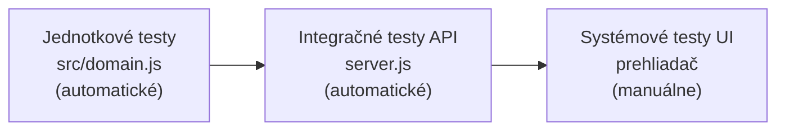
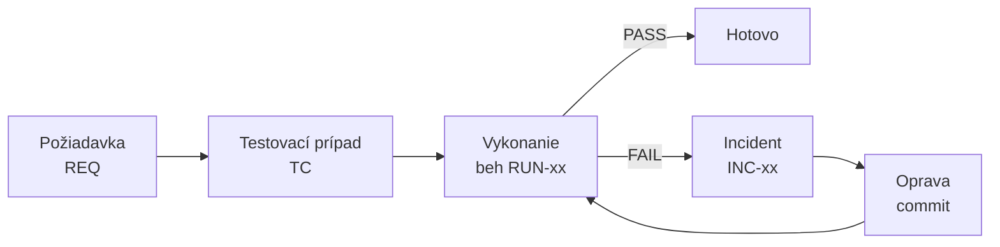
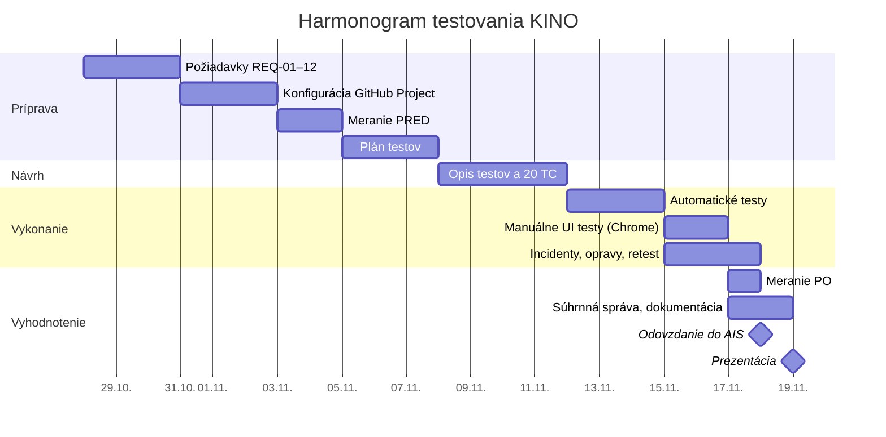
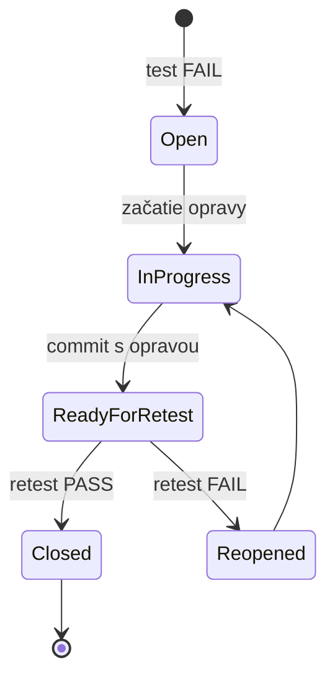

# Plán testov – KINO

| Položka | Hodnota |
|---|---|
| **Identifikátor** | LTP-KINO-001 |
| **Verzia** | 1.0 |
| **Dátum** | 17. 11. 2026 |
| **Autor** | Bc. Bohdan Lynnyk, I-API |
| **Stav** | Schválený autorom, pripravený na vykonanie |
| **Štandard** | IEEE 829-2008, štruktúra *Level Test Plan* (Úvod – Detaily – Manažment testov – Všeobecné), prispôsobená rozsahu školského projektu |

> Plán vznikol **pred** návrhom a vykonaním testov. Kritériá úspechu sú stanovené vopred, aby sa výsledky neskôr neprispôsobovali kritériám.

---

## 1. Úvod

### 1.1 Rozsah

Testuje sa modul **KINO** – webová aplikácia na výber predstavenia, sedadiel a kategórie vstupenky s výpočtom ceny a potvrdením rezervácie bez platby. Testovanie overuje, či modul spĺňa požiadavky REQ-01 až REQ-12 z dokumentu `docs/00_Poziadavky.md`.

### 1.2 Referencie

| ID | Dokument |
|---|---|
| R1 | `docs/00_Poziadavky.md` – požiadavky REQ-01 až REQ-12 |
| R2 | `docs/01_Meranie_pred.md` – meranie východiskového stavu |
| R3 | IEEE 829-2008 Standard for Software and System Test Documentation |
| R4 | ISO/IEC/IEEE 29119-4 Test techniques |
| R5 | Prednášky KSS: 05 Testovanie – štandardy, 06 Návrh testov (FEI STU) |
| R6 | Zdrojový kód: repozitár `bodyaln/ksproject`, tag `v1.0-pred` |

### 1.3 Úrovne testovania v tomto pláne

| Úroveň | Čo overuje | Ako | Nástroj |
|---|---|---|---|
| Jednotková | ceny, zľavy, limity, validácia v `src/domain.js` | automaticky | `node:test` |
| Integračná (API) | HTTP odpovede, kódy 2xx/4xx, konflikt rezervácie | automaticky | `node:test` + `fetch` |
| Systémová (UI) | správanie stránky v prehliadači | manuálne | Chrome |

### 1.4 Techniky návrhu testov

Všetky techniky sú *black-box* (podľa špecifikácie, R4, R5). Očakávané výsledky sa odvodzujú z požiadaviek R1, **nie** z výstupu aplikácie.

| Technika | Použitie v module | Požiadavky |
|---|---|---|
| **Triedy ekvivalencie** | zóny Štandard / VIP; kategórie dospelý / študent / dieťa; platné / neplatné vstupy API | REQ-03, 04, 05, 12 |
| **Hraničné hodnoty** | počet lístkov 0 / 1 / 6 / 7; čas 18:00; hranica zón rad D / rad E | REQ-02, 03, 07 |
| **Rozhodovacia tabuľka** | 2 zóny × 3 kategórie = 6 cien | REQ-04, 05, 06 |
| **Stavové prechody** | sedadlo: voľné → vybrané → rezervované; obsadené → odmietnuté | REQ-08, 09, 10, 11 |
| **Testovanie scenárov** | súbeh dvoch klientov; celý nákupný tok v UI | REQ-10, 11 |

---

## 2. Detaily

### 2.1 Testované položky

| Položka | Verzia |
|---|---|
| `src/domain.js`, `server.js`, `public/` (index.html, app.js, styles.css) | KINO 1.0.0, tag `v1.0-pred` a nasledujúce opravy |
| `docs/00_Poziadavky.md` | 1.0 |

### 2.2 Funkcie, ktoré **budú** testované

| ID | Funkcia | Priorita |
|---|---|---|
| REQ-01 | Program predstavení | P2 |
| REQ-02 | Filtre dátumu, času a sály | P2 |
| REQ-03 | Sála 48 miest, zóny Štandard / VIP | P1 |
| REQ-04 | Základná cena podľa zóny | P1 |
| REQ-05 | Zľavy podľa kategórie | P1 |
| REQ-06 | Výpočet celkovej sumy | P1 |
| REQ-07 | Limit 1–6 lístkov | P1 |
| REQ-08 | Obsadené miesto | P1 |
| REQ-09 | Zmena výberu | P2 |
| REQ-10 | Konflikt rezervácie | P1 |
| REQ-11 | Potvrdenie rezervácie | P1 |
| REQ-12 | Validácia vstupov API | P1 |

### 2.3 Funkcie, ktoré **nebudú** testované

| Funkcia | Dôvod |
|---|---|
| Platba, registrácia, prihlásenie, storno | nie sú implementované (mimo rozsahu R1) |
| Demo režim `npm run start:bug` | zámerne chybná konfigurácia, nie je prijímanou verziou |
| Výkon, záťaž, bezpečnosť (penetračné testy) | mimo rozsahu školského modulu s dátami v pamäti |
| Viac serverových procesov, databáza | architektúra má jeden proces bez databázy |
| Prehliadače okrem Chrome (Safari, Firefox), fyzický mobil | obmedzený čas; UI je štandardné HTML/CSS bez závislostí na prehliadači – riziko R6 |
| Spúšťací blok `server.js` (r. 76–89) | výpis do konzoly, nie správanie modulu |

### 2.4 Matica sledovateľnosti požiadaviek

Každá požiadavka má aspoň jeden testovací prípad (TC). Testovacie prípady budú evidované ako *sub-issues* svojej požiadavky v GitHub Project.

| Požiadavka | Testovacie prípady | Technika | Úroveň |
|---|---|---|---|
| REQ-01 | TC-01 Katalóg obsahuje 9 predstavení | triedy ekvivalencie | API |
| REQ-02 | TC-02 Hranica filtra 18:00 · TC-03 Kombinácia filtrov bez zhody | hraničné hodnoty, scenár | UI |
| REQ-03 | TC-04 Hranica zón D8 / E1 | hraničné hodnoty | jednotková |
| REQ-04, 05 | TC-05 Tabuľka 6 cien · TC-06 Podvrhnutá cena a zóna | rozhodovacia tabuľka, triedy ekvivalencie | jednotková, API |
| REQ-06 | TC-07 Zmiešaný košík 28,50 EUR · TC-08 Prepočet pri zmene kategórie | rozhodovacia tabuľka, stavové prechody | jednotková, UI |
| REQ-07 | TC-09 Hranice 0 / 1 / 6 / 7 cez API · TC-10 Siedme miesto v UI | hraničné hodnoty | jednotková, API, UI |
| REQ-08 | TC-11 Klik na obsadené miesto · TC-12 Obsadenosť oddelená medzi predstaveniami | stavové prechody | UI, API |
| REQ-09 | TC-13 Zmena predstavenia vymaže výber · TC-14 Odstránenie miesta tlačidlom × | stavové prechody | UI |
| REQ-10 | TC-15 Dvaja klienti, rovnaké miesto · TC-16 Konflikt nerezervuje zvyšok košíka | scenár, stavové prechody | API |
| REQ-11 | TC-17 Odpoveď potvrdenia (ID, suma, stav) · TC-18 Potvrdený výber je nemenný | stavové prechody, scenár | API, UI |
| REQ-12 | TC-19 Neexistujúce predstavenie, sedadlo, kategória · TC-20 Duplicita, neplatný JSON, telo nad 16 kB | triedy ekvivalencie (neplatné) | jednotková, API |

**Súhrn:** 12 požiadaviek, 20 testovacích prípadov (11 automatických, 7 manuálnych UI, 2 kombinované).

### 2.5 Prístup

1. Z každej požiadavky sa navrhnú TC podľa techník v 1.4.
2. TC sa zapíšu ako issue (`Typ položky = Testovací prípad`) a pripoja sa ako sub-issue k požiadavke.
3. Automatické TC sa implementujú v `tests/`; názov testu začína ID testovacieho prípadu (napr. `TC-05 …`).
4. Každé vykonanie dostane identifikátor behu (RUN-01, RUN-02 …) a zapíše sa do záznamu o testovaní.
5. Každá odchýlka od očakávaného výsledku = incident (issue `Typ položky = Incident`, stav podľa 3.6).
6. Po oprave sa dotknuté TC vykonajú znova (retest) a všetky automatické testy sa spustia celé (regresia).

### 2.6 Kritériá prijatia (pass / fail)

**Testovací prípad** je **PASS**, ak sa všetky očakávané výsledky zhodujú so skutočnými. Inak **FAIL** a založí sa incident. Ak TC nemožno vykonať (napr. server nebeží), je **BLOCKED** s uvedeným dôvodom. NOT_RUN ani BLOCKED sa nepočítajú ako PASS.

**Modul je prijatý**, ak platia všetky kritériá:

| # | Kritérium | Cieľ | Stav PRED |
|---|---|---|---|
| K1 | Testovacie prípady priority P1 s výsledkom PASS | **100 %** | – |
| K2 | Otvorené incidenty priority P1 | **0** | – |
| K3 | Požiadavky overené aspoň jedným TC s výsledkom PASS | **12 / 12** | 0 / 12 |
| K4 | Mutačné skóre (Stryker, `src/domain.js` + `server.js` r. 1–74) | **≥ 75 %** | 35,74 % |
| K5 | Pokrytie vetiev `src/domain.js` | **≥ 90 %** | 62,07 % |

Prežité mutanty, ktoré nemenia pozorovateľné správanie (ekvivalentné mutanty, vetva demo režimu), sa v správe zdôvodnia a vylúčia z interpretácie, nie z výpočtu skóre.

### 2.7 Kritériá pozastavenia a obnovenia

| Pozastaviť, ak | Obnoviť, keď |
|---|---|
| server sa nespustí alebo neodpovedá | server beží a `GET /api/catalog` vráti 9 predstavení |
| nie je jasné, ktorá verzia kódu sa testuje | je známy commit / tag testovanej verzie |
| zlyhá viac ako 50 % automatických testov naraz (pravdepodobne chyba prostredia) | príčina je odstránená a kontrolný test TC-05 prejde |

Jednotlivý FAIL testovanie **nepozastavuje** – zapíše sa incident a pokračuje sa nezávislými TC.

### 2.8 Vstupy a výstupy testovania

| Vstupy | Výstupy |
|---|---|
| Požiadavky R1 | Plán testov (tento dokument) |
| Zdrojový kód (tag `v1.0-pred`) | Opis testov `docs/03_Opis_testov.md` + TC v GitHub Project |
| Meranie PRED R2 | Automatické testy `tests/*.test.js` |
| Testovacie dáta: predstavenia s0-1 … s2-3, obsadené A3, B6, E2, F7 | Záznam o testovaní (log behov) |
| | Správy o incidentoch (GitHub issues) |
| | Meranie PO a súhrnná správa o testoch |

---

## 3. Manažment testov

### 3.1 Aktivity a harmonogram

Termíny sú plánovacie. Odovzdanie do AIS: **18. 11. 2026, 23:59**; prezentácia na cvičení: **19. 11. 2026**.

### 3.2 Prostredie

| Komponent | Verzia / nastavenie |
|---|---|
| Operačný systém | macOS (Apple Silicon) |
| Node.js | v22 (minimálne v20) |
| Prehliadač pre UI testy | Google Chrome, aktuálna verzia, okno 1440 × 900 |
| Server | `npm start`, adresa `http://127.0.0.1:3000`, režim normal |
| Testovací rámec | `node:test` (vstavaný v Node.js) |
| Pokrytie kódu | `node --test --experimental-test-coverage` |
| Mutačné testovanie | Stryker 8.7.1, konfigurácia `stryker.config.json` |
| Evidencia | GitHub Issues + GitHub Project „KINO – Testovanie (KS)" |

Pred každým manuálnym TC sa server reštartuje (Ctrl+C, `npm start`), aby platili východiskové testovacie dáta. Automatické testy spúšťajú vlastný server na náhodnom porte, preto sa navzájom neovplyvňujú.

### 3.3 Zodpovednosti

Školský projekt jednej osoby – všetky roly zastáva autor. Nezávislé posúdenie vykoná vyučujúci.

| Rola | Osoba | Úlohy |
|---|---|---|
| Manažér testov | Bohdan Lynnyk | plán, harmonogram, rozhodnutie o prijatí |
| Návrhár testov | Bohdan Lynnyk | opis testov, testovacie prípady |
| Tester | Bohdan Lynnyk | vykonanie, záznam, incidenty |
| Vývojár | Bohdan Lynnyk | opravy chýb |
| Posudzovateľ | vyučujúci KSS | hodnotenie výstupov |

### 3.4 Komunikácia

Všetky zistenia, stavy a dôkazy sú v GitHub (issues, Project, commity). Incident obsahuje odkaz na TC a požiadavku; oprava v commite odkazuje na incident (`Fixes #číslo`).

### 3.5 Potrebné znalosti

Spustenie Node.js projektu, základy HTTP / JSON, práca s prehliadačom a DevTools, zápis výsledkov do GitHub Project. Školenie nie je potrebné.

### 3.6 Životný cyklus incidentu

Stav sa eviduje v poli **Stav incidentu** v GitHub Project (Open, In Progress, Ready for Retest, Closed, Reopened).

### 3.7 Riziká a opatrenia

| ID | Riziko | Pravdepodobnosť | Dopad | Opatrenie |
|---|---|---|---|---|
| R1 | Nesprávna cena pri zľave alebo VIP zóne | stredná | vysoký | úplná rozhodovacia tabuľka 6 cien (TC-05), mutačné testovanie |
| R2 | Prekročenie limitu 6 lístkov | stredná | vysoký | hraničné hodnoty 0 / 1 / 6 / 7 v API aj UI (TC-09, TC-10) |
| R3 | Dvojitá rezervácia toho istého miesta | stredná | vysoký | test súbehu dvoch klientov (TC-15, TC-16) |
| R4 | Zvyšné rezervácie z predchádzajúceho testu skreslia výsledok | vysoká | stredný | reštart servera pred manuálnym TC; izolovaný server pre každý automatický test |
| R5 | Chýbajúci čas pre všetky TC | stredná | stredný | najprv P1 TC, potom P2 |
| R6 | Odlišné správanie v inom prehliadači | nízka | stredný | mimo rozsahu; uvedené ako obmedzenie v súhrnnej správe |
| R7 | Testy sa prispôsobia kódu namiesto požiadavkám | stredná | vysoký | očakávané hodnoty len z R1; kritériá K1–K5 stanovené vopred |

### 3.8 Náklady

Bez licenčných nákladov: Node.js, Stryker, GitHub (verejný repozitár) a Chrome sú bezplatné.

---

## 4. Všeobecné

### 4.1 Zabezpečenie kvality testovania

- Každý TC má väzbu na požiadavku (matica 2.4); TC bez požiadavky sa nepridáva.
- Očakávané ceny sa prepočítajú ručne z tabuľky v R1 ešte pred spustením testu.
- Pôvodný FAIL sa po oprave neprepisuje – retest je nový záznam s novým RUN ID.
- Stav PRED a PO je zachytený tagmi v Git (`v1.0-pred`, `v1.1-po`) a dá sa porovnať príkazom `git diff`.

### 4.2 Sledované metriky

| Metrika | Výpočet | Zdroj |
|---|---|---|
| Počet TC podľa výsledku | PASS / FAIL / BLOCKED / NOT_RUN | GitHub Project, pole Výsledok testu |
| Percento úspešnosti | PASS / (PASS + FAIL) | záznam o testovaní |
| Pokrytie požiadaviek | požiadavky s aspoň 1 PASS TC / 12 | matica 2.4 + Project |
| Pokrytie kódu | riadky, vetvy, funkcie | `npm run test:coverage` |
| Mutačné skóre | (zabité + timeout) / všetky mutanty | `npm run test:mutation` |
| Incidenty | počet podľa priority a stavu | GitHub Project, pole Stav incidentu |

### 4.3 Glosár

| Pojem | Význam |
|---|---|
| REQ | požiadavka na systém |
| TC | testovací prípad (test case) |
| RUN | jeden beh vykonania testov |
| INC | incident – zistená odchýlka od očakávaného výsledku |
| P1 / P2 / P3 | priorita: kritická / stredná / nízka |
| PASS / FAIL / BLOCKED / NOT_RUN | vyhovel / nevyhovel / nemožno vykonať / nevykonaný |
| Mutant | kópia kódu s jednou úmyselnou zmenou; test ho „zabije", ak zlyhá |
| Mutačné skóre | podiel zabitých mutantov – meria, či testy odhalia chyby |
| Fixture | východiskové testovacie dáta (obsadené A3, B6, E2, F7) |

### 4.4 História dokumentu

| Verzia | Dátum | Zmena |
|---|---|---|
| 1.0 | 17. 11. 2026 | Prvá verzia plánu po meraní stavu PRED |
