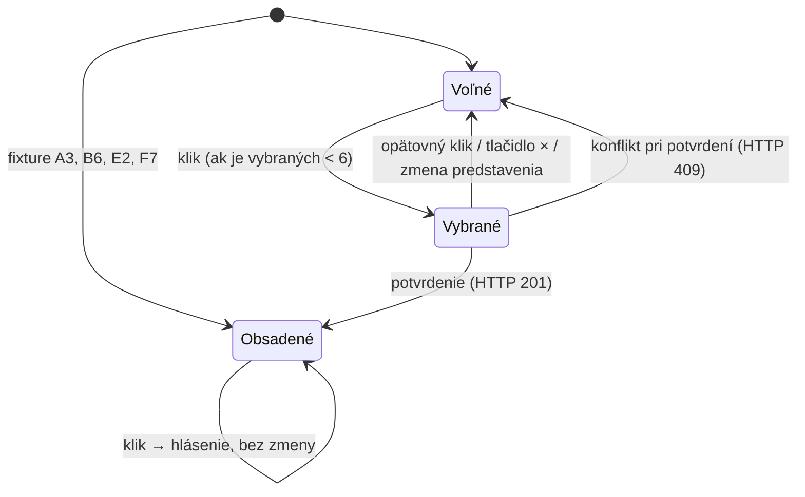

# Opis testov – KINO

| Položka | Hodnota |
|---|---|
| **Identifikátor** | LTD-KINO-001 |
| **Verzia** | 1.0 |
| **Dátum** | 17. 11. 2026 |
| **Autor** | Bc. Bohdan Lynnyk, I-API |
| **Nadradený dokument** | Plán testov LTP-KINO-001 (`docs/02_Plan_testov.md`) |
| **Štandard** | IEEE 829-2008: Opis návrhu testov, Opis testovacích prípadov, Opis procedúr testovania |

Dokument má tri časti podľa IEEE 829:

| Časť | Otázka | Obsah |
|---|---|---|
| [1. Opis návrhu testov](#1-opis-návrhu-testov) | **ČO** sa testuje a akým prístupom | funkcie, techniky, kritérium PASS/FAIL |
| [2. Opis testovacích prípadov](#2-opis-testovacích-prípadov) | **AKO** – s akými vstupmi a výstupmi | 20 prípadov TC-01 až TC-20 |
| [3. Opis procedúr testovania](#3-opis-procedúr-testovania) | **AKÝMI KROKMI** sa prípady spúšťajú | procedúry PR-01 až PR-04 |

---

## 1. Opis návrhu testov

### 1.1 Identifikátor

LTD-KINO-001, sada testov „KINO – výber, cena a rezervácia".

### 1.2 Testované funkcie

Všetky požiadavky REQ-01 až REQ-12 z `docs/00_Poziadavky.md` (rozsah a vylúčenia: Plán testov, kap. 2.2 a 2.3).

### 1.3 Detaily k prístupu z plánu testov

**Spoločné vlastnosti všetkých testov**

- Black-box testy podľa špecifikácie. Očakávané hodnoty sú vypočítané ručne z požiadaviek **pred** vykonaním testu, nikdy podľa výstupu aplikácie.
- Testovacie dáta (fixture) po štarte servera: 9 predstavení `s0-1` … `s2-3`; v každom obsadené A3, B6, E2, F7; ostatné miesta voľné.
- Ceny v API sú v centoch (1050 = 10,50 EUR), v UI vo formáte `10,50 €`.
- Automatické testy (`tests/*.test.js`) majú názov začínajúci ID prípadu, napr. `TC-05 …`, aby sa výsledok dal priradiť ku karte v GitHub Project.

**Použité techniky a ich aplikácia**

| Technika | Triedy / hranice / stavy v module | Prípady |
|---|---|---|
| Triedy ekvivalencie | zóna {Štandard, VIP}; kategória {dospelý, študent, dieťa}; vstup {platný, neexistujúce predstavenie, neexistujúce sedadlo, neznáma kategória, duplicita, neplatný JSON, príliš veľké telo} | TC-01, 05, 06, 19, 20 |
| Hraničné hodnoty | počet lístkov **0 / 1 / 6 / 7**; čas **18:00** (17:59 → Do 18:00, 18:00 → Od 18:00); zóny **D8 / E1** | TC-02, 04, 09, 10 |
| Rozhodovacia tabuľka | 2 zóny × 3 kategórie = 6 pravidiel ceny | TC-05, 07, 08 |
| Stavové prechody | sedadlo: voľné → vybrané → (zrušené \| rezervované); obsadené → odmietnuté; výber → potvrdený (nemenný) | TC-08, 11, 13, 14, 16, 18 |
| Scenáre | dvaja klienti naraz; celý nákup v UI; kombinácia filtrov | TC-03, 15, 18 |

**Rozhodovacia tabuľka cien** (zdroj očakávaných hodnôt pre TC-04 až TC-08)

| Pravidlo | 1 | 2 | 3 | 4 | 5 | 6 |
|---|---|---|---|---|---|---|
| Zóna | Štandard | Štandard | Štandard | VIP | VIP | VIP |
| Kategória | dospelý | študent | dieťa | dospelý | študent | dieťa |
| Výpočet | 1000 × 100 % | 1000 × 80 % | 1000 × 70 % | 1500 × 100 % | 1500 × 80 % | 1500 × 70 % |
| **Cena** | **10,00 €** | **8,00 €** | **7,00 €** | **15,00 €** | **12,00 €** | **10,50 €** |

**Stavový diagram sedadla** (zdroj pre TC-08, 11, 13, 14, 16, 18)

### 1.4 Kritérium splnenia / nesplnenia

| Výsledok | Kedy |
|---|---|
| **PASS** | všetky očakávané výsledky a následky prípadu sa zhodujú so skutočnosťou |
| **FAIL** | aspoň jedna odchýlka; založí sa incident (PR-02 krok 6) |
| **BLOCKED** | prípad nemožno vykonať (server nebeží, chýba prostredie); uvedie sa dôvod |
| **NOT_RUN** | prípad ešte nebol vykonaný |

Požiadavka je overená, ak má aspoň jeden prípad s výsledkom PASS a žiadny otvorený FAIL.

### 1.5 Vstupy a výstupy

| Vstupy | Výstupy |
|---|---|
| požiadavky REQ-01 až REQ-12, plán testov, zdrojový kód (commit / tag), fixture | výsledok každého TC v poli **Výsledok testu** (GitHub Project), záznam o testovaní, incidenty, výstupy `npm test`, pokrytie, mutačná správa |

---

## 2. Opis testovacích prípadov

### 2.1 Prehľad

| ID | Názov | REQ | Priorita | Technika | Spôsob |
|---|---|---|---|---|---|
| TC-01 | Katalóg obsahuje 9 predstavení | 01 | P2 | triedy ekvivalencie | auto (API) |
| TC-02 | Hranica filtra 18:00 | 02 | P2 | hraničné hodnoty | manuálny UI |
| TC-03 | Kombinácia filtrov bez zhody | 02 | P2 | scenár | manuálny UI |
| TC-04 | Hranica zón D8 / E1 | 03 | P1 | hraničné hodnoty | auto (jednotkový) |
| TC-05 | Rozhodovacia tabuľka 6 cien | 04, 05 | P1 | rozhodovacia tabuľka | auto (jednotkový) |
| TC-06 | Podvrhnutá cena a zóna | 04, 12 | P1 | triedy ekvivalencie | auto (API) |
| TC-07 | Zmiešaný košík 28,50 € | 06 | P1 | rozhodovacia tabuľka | auto + manuálny UI |
| TC-08 | Prepočet pri zmene kategórie | 05, 06 | P1 | stavové prechody | manuálny UI |
| TC-09 | Hranice počtu lístkov 0 / 1 / 6 / 7 | 07 | P1 | hraničné hodnoty | auto (jednotkový + API) |
| TC-10 | Siedme miesto v UI | 07 | P1 | hraničné hodnoty | manuálny UI |
| TC-11 | Klik na obsadené miesto | 08 | P1 | stavové prechody | manuálny UI |
| TC-12 | Obsadenosť oddelená medzi predstaveniami | 08 | P1 | triedy ekvivalencie | auto (API) |
| TC-13 | Zmena predstavenia vymaže výber | 09 | P2 | stavové prechody | manuálny UI |
| TC-14 | Odstránenie miesta | 09 | P2 | stavové prechody | manuálny UI |
| TC-15 | Dvaja klienti, rovnaké miesto | 10 | P1 | scenár | auto (API) |
| TC-16 | Konflikt nerezervuje zvyšok košíka | 10 | P1 | stavové prechody | auto (API) |
| TC-17 | Odpoveď potvrdenia | 11 | P1 | triedy ekvivalencie | auto (API) |
| TC-18 | Potvrdený výber je nemenný, nový výber | 11 | P1 | scenár, stavové prechody | manuálny UI |
| TC-19 | Neexistujúce predstavenie, sedadlo, kategória | 12 | P1 | triedy ekvivalencie (neplatné) | auto (jednotkový + API) |
| TC-20 | Duplicita, neplatný JSON, veľké telo | 12 | P1 | triedy ekvivalencie (neplatné) | auto (API) |

**Spolu:** 20 prípadov, 15 × P1, 5 × P2; 11 automatických, 8 manuálnych UI, 1 kombinovaný (TC-07).

**Spoločné predpoklady** pre všetky prípady (ak nie je uvedené inak): server v režime normal spustený podľa PR-01 s čistou fixture; predstavenie `s0-1` (21. 10. 2026, 15:00, Sála 1). **Prostredie:** Plán testov, kap. 3.2. **Závislosti:** žiadny prípad nezávisí od výsledku iného prípadu; každý sa dá vykonať samostatne po PR-01.

### 2.2 Prípady

#### TC-01 Katalóg obsahuje 9 predstavení

| | |
|---|---|
| **Požiadavka / priorita** | REQ-01 · P2 |
| **Účel** | Overiť, že program obsahuje presne predpísané predstavenia. |
| **Procedúra** | PR-03 |
| **Vstup** | `GET /api/catalog` |
| **Očakávaný výstup** | HTTP 200; `sessions` má 9 položiek; dátumy 2026-10-21, 22, 23; každý deň 15:00 Sála 1, 18:00 Sála 1, 19:30 Sála 2; `mode` = `normal` |
| **Následky** | žiadne (iba čítanie) |

#### TC-02 Hranica filtra 18:00

| | |
|---|---|
| **Požiadavka / priorita** | REQ-02 · P2 |
| **Účel** | Overiť, že predstavenie presne o 18:00 patrí do „Od 18:00", nie do „Do 18:00". |
| **Procedúra** | PR-02 |
| **Kroky** | 1. Dátum 21. 10. 2026, Sála „Všetky sály". 2. Čas „Do 18:00". 3. Čas „Od 18:00". |
| **Očakávaný výstup** | krok 2: zobrazí sa iba 15:00; krok 3: zobrazí sa 18:00 a 19:30 |
| **Následky** | po zmene filtra je automaticky vybraté prvé zobrazené predstavenie, košík je prázdny |

#### TC-03 Kombinácia filtrov bez zhody

| | |
|---|---|
| **Požiadavka / priorita** | REQ-02 · P2 |
| **Účel** | Overiť súčasné uplatnenie filtrov a správanie bez výsledku. |
| **Procedúra** | PR-02 |
| **Kroky** | 1. Dátum 21. 10. 2026. 2. Sála „Sála 2". 3. Čas „Do 18:00". 4. Čas späť „Všetky časy". |
| **Očakávaný výstup** | krok 3: text „Pre zvolené filtre nie je dostupné predstavenie.", schéma sedadiel prázdna, v súhrne „Zmeňte filtre a vyberte predstavenie."; krok 4: zobrazí sa 19:30 Sála 2 a jeho schéma |
| **Následky** | žiadne |

#### TC-04 Hranica zón D8 / E1

| | |
|---|---|
| **Požiadavka / priorita** | REQ-03 · P1 |
| **Účel** | Overiť hranicu medzi poslednou štandardnou a prvou VIP radou a rozsah sály. |
| **Procedúra** | PR-03 |
| **Vstup** | `calculateQuote` s D8 / dospelý, E1 / dospelý; zoznam `SEATS` |
| **Očakávaný výstup** | D8: zóna `standard`, 1000 centov; E1: zóna `vip`, 1500 centov; `SEATS` má 48 miest A1 … F8, rady A–D `standard`, E–F `vip` |
| **Následky** | žiadne |

#### TC-05 Rozhodovacia tabuľka 6 cien

| | |
|---|---|
| **Požiadavka / priorita** | REQ-04, REQ-05 · P1 |
| **Účel** | Overiť všetkých 6 pravidiel rozhodovacej tabuľky (kap. 1.3). |
| **Procedúra** | PR-03 |
| **Vstup** | A1 a E1, každé s kategóriou adult, student, child (6 samostatných výpočtov) |
| **Očakávaný výstup** | A1: 1000 / 800 / 700; E1: 1500 / 1200 / 1050 centov |
| **Následky** | žiadne |

#### TC-06 Podvrhnutá cena a zóna

| | |
|---|---|
| **Požiadavka / priorita** | REQ-04, REQ-12 · P1 |
| **Účel** | Overiť, že cenu a zónu určuje server, nie klient. |
| **Procedúra** | PR-03 |
| **Vstup** | `POST /api/quote` `{"sessionId":"s0-1","tickets":[{"seatId":"E1","type":"adult","priceCents":1,"zone":"standard"}]}` |
| **Očakávaný výstup** | HTTP 200; položka E1 má `zone` = `vip`, `priceCents` = 1500; `totalCents` = 1500 |
| **Následky** | žiadne |

#### TC-07 Zmiešaný košík 28,50 €

| | |
|---|---|
| **Požiadavka / priorita** | REQ-06 · P1 |
| **Účel** | Overiť súčet viacerých lístkov rôznych zón a kategórií. |
| **Procedúra** | PR-03 (automatická časť), PR-02 (UI časť) |
| **Vstup** | A1 dospelý, A2 študent, E1 dieťa |
| **Kroky UI** | vybrať A1, A2, E1; pri A2 zvoliť „Študent −20 %", pri E1 „Dieťa −30 %" |
| **Očakávaný výstup** | API: položky 1000, 800, 1050; `totalCents` = 2850. UI: položky 10,00 €, 8,00 €, 10,50 €; Spolu 28,50 €; počítadlo 3 / 6 |
| **Následky** | výber zostane (bez rezervácie) |

#### TC-08 Prepočet pri zmene kategórie

| | |
|---|---|
| **Požiadavka / priorita** | REQ-05, REQ-06 · P1 |
| **Účel** | Overiť, že opakovaná zmena kategórie prepočíta cenu a zľavy sa nekumulujú. |
| **Procedúra** | PR-02 |
| **Kroky** | 1. Vybrať A1. 2. Kategória Študent. 3. Dieťa. 4. Dospelý. |
| **Očakávaný výstup** | po kroku 1: 10,00 €; 2: 8,00 €; 3: 7,00 € (nie 5,60 €); 4: 10,00 €; položka aj Spolu sa zhodujú |
| **Následky** | výber zostane |

#### TC-09 Hranice počtu lístkov 0 / 1 / 6 / 7

| | |
|---|---|
| **Požiadavka / priorita** | REQ-07 · P1 |
| **Účel** | Overiť obe hranice limitu na jednotkovej úrovni aj cez API. |
| **Procedúra** | PR-03 |
| **Vstup** | 0 lístkov; 1 lístok (A1); 6 lístkov (A1, A2, A4, A5, A6, A7); 7 lístkov (+ A8) |
| **Očakávaný výstup** | 0 → chyba 400 `MIN_TICKETS` „Vyberte aspoň 1 vstupenku."; 1 → OK 1000; 6 → OK 6000; 7 → chyba 400 `MAX_TICKETS` „Maximálny počet vstupeniek na jedno predstavenie je 6." |
| **Následky** | pri odmietnutí sa nič nerezervuje |

#### TC-10 Siedme miesto v UI

| | |
|---|---|
| **Požiadavka / priorita** | REQ-07 · P1 |
| **Účel** | Overiť limit v rozhraní a hlásenie pri prázdnom výbere. |
| **Procedúra** | PR-02 |
| **Kroky** | 1. Bez výberu kliknúť „Potvrdiť výber". 2. Vybrať A1, A2, A4, A5, A6, A7. 3. Kliknúť A8. |
| **Očakávaný výstup** | krok 1: hlásenie „Vyberte aspoň 1 vstupenku."; krok 2: počítadlo 6 / 6, Spolu 60,00 €; krok 3: hlásenie „Maximálny počet vstupeniek na jedno predstavenie je 6.", A8 sa nepridá, počítadlo ostáva 6 / 6 |
| **Následky** | bez rezervácie |

#### TC-11 Klik na obsadené miesto

| | |
|---|---|
| **Požiadavka / priorita** | REQ-08 · P1 |
| **Účel** | Overiť prechod obsadené → odmietnuté v UI. |
| **Procedúra** | PR-02 |
| **Kroky** | 1. Skontrolovať vzhľad A3, B6, E2, F7. 2. Kliknúť na A3. |
| **Očakávaný výstup** | krok 1: štyri miesta sú zobrazené ako obsadené; krok 2: hlásenie „Toto sedadlo je obsadené. Vyberte iné miesto.", A3 sa nepridá, počítadlo 0 / 6 |
| **Následky** | žiadne |

#### TC-12 Obsadenosť oddelená medzi predstaveniami

| | |
|---|---|
| **Požiadavka / priorita** | REQ-08 · P1 |
| **Účel** | Overiť, že rezervácia v jednom predstavení neobsadí miesto v inom. |
| **Procedúra** | PR-03 |
| **Kroky / vstup** | 1. `POST /api/reservations` s0-1, A1 dospelý. 2. `GET /api/seats/s0-1`. 3. `GET /api/seats/s0-2`. |
| **Očakávaný výstup** | 1: HTTP 201; 2: A1 `occupied: true`; 3: A1 `occupied: false` |
| **Následky** | A1 v s0-1 je rezervované (izolovaný server testu) |

#### TC-13 Zmena predstavenia vymaže výber

| | |
|---|---|
| **Požiadavka / priorita** | REQ-09 · P2 |
| **Účel** | Overiť prechod vybrané → voľné pri zmene predstavenia. |
| **Procedúra** | PR-02 |
| **Kroky** | 1. V s0-1 vybrať A1, A2. 2. Kliknúť na predstavenie 18:00. |
| **Očakávaný výstup** | po kroku 2: počítadlo 0 / 6, Spolu 0,00 €, v súhrne názov a čas nového predstavenia, A1 a A2 nie sú označené |
| **Následky** | žiadne |

#### TC-14 Odstránenie miesta

| | |
|---|---|
| **Požiadavka / priorita** | REQ-09 · P2 |
| **Účel** | Overiť oba spôsoby zrušenia výberu a prepočet sumy. |
| **Procedúra** | PR-02 |
| **Kroky** | 1. Vybrať A1, A2 (Spolu 20,00 €). 2. V súhrne pri A2 kliknúť ×. 3. Znova kliknúť na A1 v schéme. |
| **Očakávaný výstup** | po kroku 2: 1 / 6, Spolu 10,00 €; po kroku 3: 0 / 6, Spolu 0,00 € |
| **Následky** | žiadne |

#### TC-15 Dvaja klienti, rovnaké miesto

| | |
|---|---|
| **Požiadavka / priorita** | REQ-10 · P1 |
| **Účel** | Overiť, že pri súbehu uspeje iba jeden klient. |
| **Procedúra** | PR-03 |
| **Vstup** | dve súčasné požiadavky `POST /api/reservations` s0-1, A1 dospelý |
| **Očakávaný výstup** | jedna odpoveď HTTP 201, druhá HTTP 409 `SEAT_TAKEN` |
| **Následky** | A1 je rezervované práve raz |

#### TC-16 Konflikt nerezervuje zvyšok košíka

| | |
|---|---|
| **Požiadavka / priorita** | REQ-10 · P1 |
| **Účel** | Overiť atomickosť: pri konflikte sa nerezervuje ani voľná časť košíka. |
| **Procedúra** | PR-03 |
| **Kroky / vstup** | 1. Klient B rezervuje A1. 2. Klient A rezervuje A1 + A2. 3. `GET /api/seats/s0-1`. |
| **Očakávaný výstup** | 1: 201; 2: 409 `SEAT_TAKEN`; 3: A1 `occupied: true`, A2 `occupied: false` |
| **Následky** | rezervované iba A1 |

#### TC-17 Odpoveď potvrdenia

| | |
|---|---|
| **Požiadavka / priorita** | REQ-11 · P1 |
| **Účel** | Overiť obsah úspešného potvrdenia. |
| **Procedúra** | PR-03 |
| **Vstup** | `POST /api/reservations` s0-1, E1 dieťa |
| **Očakávaný výstup** | HTTP 201; `id` vo formáte UUID; `sessionId` = `s0-1`; `totalCents` = 1050; `status` = `reserved-unpaid`; následne E1 v s0-1 `occupied: true` |
| **Následky** | E1 rezervované |

#### TC-18 Potvrdený výber je nemenný, nový výber

| | |
|---|---|
| **Požiadavka / priorita** | REQ-11 · P1 |
| **Účel** | Overiť celý nákupný tok v UI a stav po potvrdení. |
| **Procedúra** | PR-02 |
| **Kroky** | 1. Vybrať A1 (dospelý) a E1 (Dieťa −30 %). 2. Kliknúť „Potvrdiť výber". 3. Skúsiť kliknúť na A2 a zmeniť kategóriu A1. 4. Kliknúť „Začať nový výber". |
| **Očakávaný výstup** | krok 2: „Výber je potvrdený. Spolu 20,50 €. Rezervácia ‹ID›. Platba nebola vykonaná."; krok 3: nič sa nezmení (sedadlá a kategórie neaktívne); krok 4: prázdny košík 0 / 6, A1 a E1 sú zobrazené ako obsadené |
| **Následky** | A1 a E1 v s0-1 rezervované – pred ďalším prípadom reštart (PR-01) |

#### TC-19 Neexistujúce predstavenie, sedadlo, kategória

| | |
|---|---|
| **Požiadavka / priorita** | REQ-12 · P1 |
| **Účel** | Overiť odmietnutie neplatných hodnôt bez chyby servera. |
| **Procedúra** | PR-03 |
| **Vstup** | a) `sessionId` = `s9-9`; b) `seatId` = `Z9`; c) `type` = `senior`; d) `GET /api/seats/s9-9` |
| **Očakávaný výstup** | a) 404 „Predstavenie neexistuje."; b) 400 „Sedadlo neexistuje."; c) 400 „Neplatný typ vstupenky."; d) 404; žiadna odpoveď 500; obsadenosť s0-1 nezmenená |
| **Následky** | žiadne |

#### TC-20 Duplicita, neplatný JSON, veľké telo

| | |
|---|---|
| **Požiadavka / priorita** | REQ-12 · P1 |
| **Účel** | Overiť odmietnutie chybne zostavených požiadaviek. |
| **Procedúra** | PR-03 |
| **Vstup** | a) A1 dvakrát v jednej požiadavke; b) telo `{nie je json`; c) telo väčšie ako 16 384 bajtov; d) `tickets` nie je pole |
| **Očakávaný výstup** | a) 400 „Sedadlo nemožno vybrať dvakrát."; b) 400 „Neplatný JSON."; c) 413 „Požiadavka je príliš veľká."; d) 400 „Neplatný zoznam vstupeniek."; žiadna odpoveď 500; obsadenosť nezmenená |
| **Následky** | žiadne |

---

## 3. Opis procedúr testovania

### PR-01 Príprava prostredia a testovacích dát

| | |
|---|---|
| **Účel** | Zabezpečiť známu verziu kódu a čistú fixture. |
| **Požiadavky** | Node.js ≥ 20, terminál, priečinok projektu |
| **Kroky** | 1. `git log -1 --oneline` – zapísať commit testovanej verzie. 2. Ak server beží, zastaviť ho (Ctrl+C). 3. Spustiť `npm start`. 4. Overiť výpis „normálny režim" a adresu `http://127.0.0.1:3000`. |
| **Ukončenie** | Ctrl+C v termináli servera |
| **Neštandardné situácie** | „Port 3000 je obsadený" → zastaviť druhý server alebo `PORT=3001 npm start`; server sa nespustí → prípady BLOCKED (Plán testov 2.7) |

### PR-02 Vykonanie manuálneho UI prípadu

| | |
|---|---|
| **Účel** | Jednotný postup pre TC-02, 03, 07 (UI), 08, 10, 11, 13, 14, 18. |
| **Požiadavky** | PR-01 hotová; Google Chrome; GitHub Project otvorený v druhej karte |
| **Kroky** | 1. **Príprava:** otvoriť `http://127.0.0.1:3000`, obnoviť stránku (Cmd+R). 2. **Začiatok:** skontrolovať, že nie je zobrazený DEMO banner a je vybrané 21. 10. 2026, 15:00 Sála 1. 3. **Vykonanie:** vykonať kroky prípadu presne v uvedenom poradí. 4. **Meranie:** porovnať každý očakávaný výstup so skutočnosťou (text hlásenia, ceny položiek, Spolu, počítadlo). 5. **Záznam:** v Project nastaviť Výsledok testu; do záznamu o testovaní zapísať RUN ID, dátum, TC, výsledok; pri FAIL urobiť snímku obrazovky. 6. **Pri FAIL:** založiť incident (issue, Typ položky = Incident, Stav incidentu = Open) s krokmi, očakávaným a skutočným výsledkom, prepojiť s TC. 7. **Ukončenie:** ak prípad niečo rezervoval (TC-18), vykonať PR-01. |
| **Neštandardné situácie** | cena zobrazuje „…" dlhšie ako 2 s → obnoviť stránku a zopakovať; chyba „Aplikáciu sa nepodarilo načítať" → BLOCKED, PR-01 |

### PR-03 Spustenie automatických testov

| | |
|---|---|
| **Účel** | Vykonať TC-01, 04, 05, 06, 07 (API), 09, 12, 15, 16, 17, 19, 20. |
| **Požiadavky** | Node.js ≥ 20; server **nemusí** bežať – každý test spúšťa vlastný server na náhodnom porte |
| **Kroky** | 1. `npm test`. 2. Vo výstupe nájsť riadky `ok` / `not ok` s ID prípadov. 3. Pre každý TC nastaviť Výsledok testu v Project. 4. Uložiť výstup: `npm test > docs/merania/po/npm-test.txt`. 5. Pri `not ok` postupovať ako PR-02 krok 6. |
| **Neštandardné situácie** | zlyhá viac ako polovica testov naraz → overiť verziu Node.js a `git status` (Plán testov 2.7) |

### PR-04 Meranie pokrytia a mutačného skóre

| | |
|---|---|
| **Účel** | Zmerať kritériá K4 a K5 z plánu testov rovnakým spôsobom ako v stave PRED. |
| **Požiadavky** | `npm install` (Stryker) |
| **Kroky** | 1. `npm run test:coverage` → uložiť výstup. 2. `npm run test:mutation` → správa `reports/mutation/mutation.html`. 3. Skopírovať výsledky do `docs/merania/po/`. 4. Zapísať hodnoty do súhrnnej správy a porovnať so stavom PRED. |
| **Neštandardné situácie** | Stryker hlási chybu počiatočného behu → najprv opraviť zlyhávajúce testy (`npm test` musí prejsť) |

---

## História dokumentu

| Verzia | Dátum | Zmena |
|---|---|---|
| 1.0 | 17. 11. 2026 | Prvá verzia: návrh, 20 testovacích prípadov, 4 procedúry |
